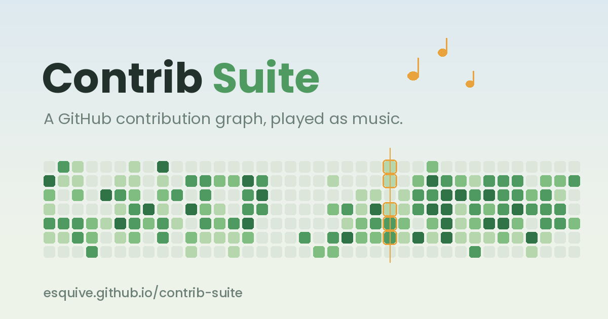

# Contrib Suite

Your GitHub contribution graph, played as music.

**Live: https://esquive.github.io/contrib-suite/**



A contribution graph is already a piano roll — seven rows, read left to right, with intensity baked in. Contrib Suite reads it as one. Paste a profile URL and it plays your last twelve months back to you as a slow pentatonic piece, one week per bar.

## How the mapping works

- **Rows are pitch.** Sunday is the highest voice, Saturday the lowest, over a five-note scale so nothing can clash.
- **Shade is loudness.** The deepest green also adds a small bell above the note.
- **A week is a bar**, played bottom-up as a rising arpeggio. Busy weeks fill a whole bar, a week with one or two commits takes half of one, and an empty week passes in a single beat — so a holiday goes by quickly instead of leaving a minute of silence.
- **Underneath**, a bass and a string pad keep an eight-bar progression turning without pause. When nothing is happening on the grid, the pad picks out a quiet figure of its own.

Nothing is sampled. Every note is synthesised in the browser at the moment it sounds.

## Using it

Paste a GitHub profile URL (or just a handle) and press **Load my year**.

If the live fetch is blocked — some sandboxed hosts refuse outbound requests — open the *Load it by hand* section, which gives you a one-line console snippet to run on your own profile page. It reads the squares already rendered there and copies them to your clipboard. It sends nothing anywhere.

You can also draw a year yourself. Turn on painting and pick a brush: `−` and `+` step a square one shade lighter or darker, or paint an absolute shade straight on. Anything you change keeps a gold outline until it is back where it started.

**Record and save** plays the piece through once while capturing the audio, then hands you a `.webm`. It runs in real time, so a two-minute piece takes two minutes.

## Running it locally

One file, no build step, no dependencies to install:

```sh
git clone https://github.com/Esquive/contrib-suite.git
cd contrib-suite
python3 -m http.server 8000
```

Then open http://localhost:8000. Opening `index.html` directly off the filesystem mostly works too, but a `file://` origin can upset the live fetch, so the local server is the safer route.

## Deploying

It is a single static file. Push it, then **Settings → Pages → Deploy from a branch → `main` / `/ (root)`**. No Actions workflow required.

## Built with

- [Tone.js](https://tonejs.github.io/) — synthesis and scheduling (MIT)
- Zen Maru Gothic via Google Fonts (SIL OFL 1.1)
- [github-contributions-api](https://github.com/grubersjoe/github-contributions-api) by Jonathan Gruber — the free, no-auth endpoint behind the live fetch. Please be considerate with it.

## Notices

Not affiliated with GitHub, Inc. See [NOTICE.md](NOTICE.md) for the full credits, privacy notes and disclaimers.

## Licence

MIT — see [LICENSE](LICENSE).
